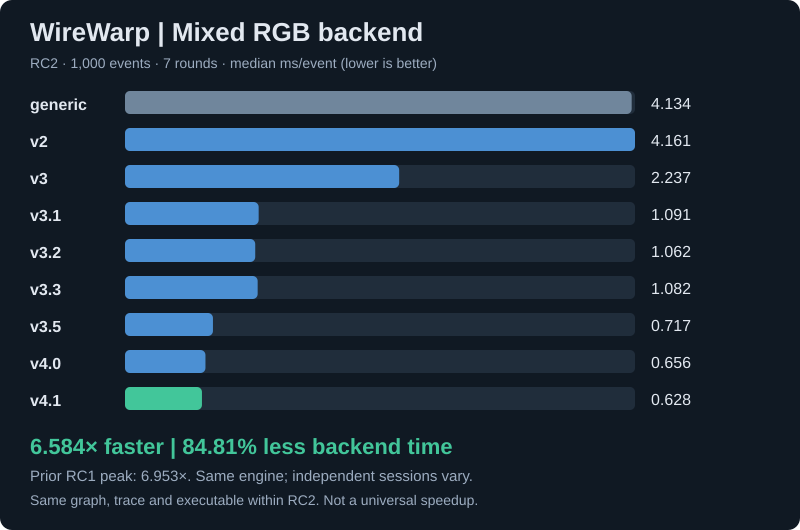
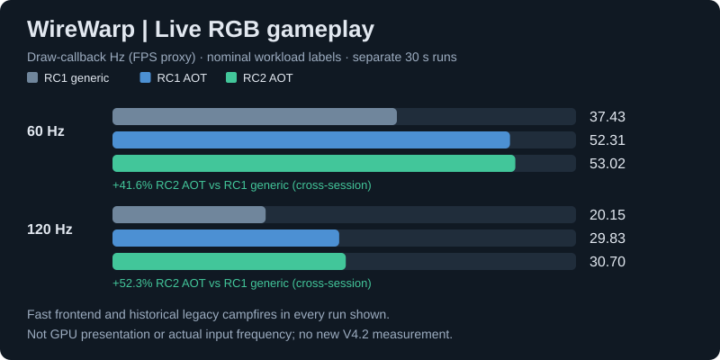
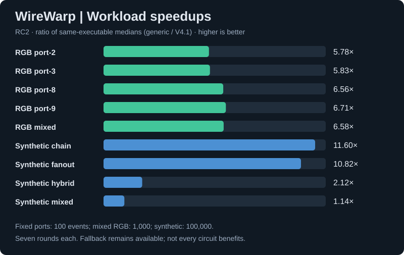
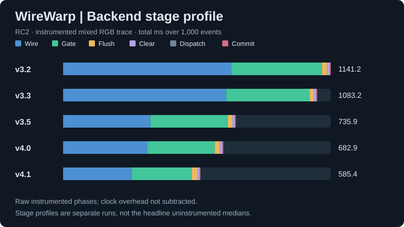
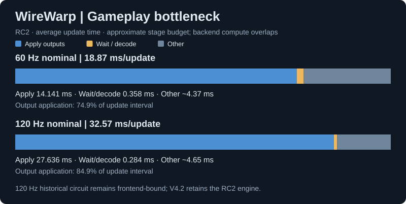
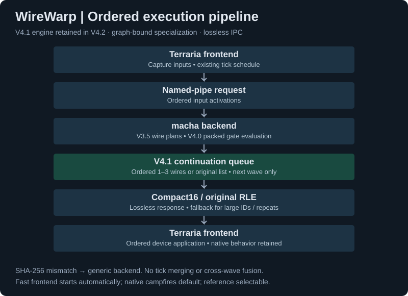
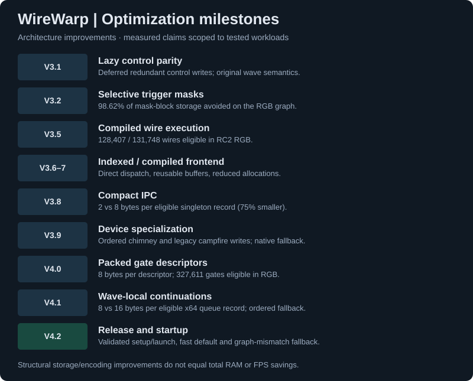

# WireWarp — AOT V4.2

**V4.2 · Windows source release · AOT V4.1 · mod version 0.1.11**

Promoted from the tested RC3 startup workflow. This package is prepared for maintainer review and publication; see the [release gates](docs/RELEASE-CHECKLIST.md) for remaining scope and rights checks.

WireWarp accelerates Terraria wiring using a tModLoader C# frontend and a graph-specialized Zig backend (macha). Original project by [yfdyzjt](https://github.com/yfdyzjt/WireWarp). Licensed under [GPL-3.0-only](LICENSE), subject to the remaining [attribution and rights review](ATTRIBUTION.md).



## Quick start (Windows)

### Requirements
- Terraria and compatible tModLoader (the development build used in testing; exact supported version range is still being verified).
- [Python 3.12](https://www.python.org/downloads/) and [Zig 0.16.0](https://ziglang.org/download/) on PATH. Open a new CMD window and check `python --version` and `zig version` if needed.
- A **local backup copy of your world**, not a Steam Cloud world. WireWarp intercepts wiring input; use backed-up worlds because universal vanilla equivalence has not been established.

### First time / new or changed world
1. Download and extract the entire WireWarp source package. Copy its `WireWarp` folder into your active tModLoader `ModSources` directory. In tModLoader, open Workshop → Develop Mods and choose **Build + Reload** for WireWarp.
2. Open your local test world. WireWarp exports the wiring graph and waits for a backend connection. Leave Terraria waiting.
3. In the extracted `macha` folder, double-click **`Setup.cmd`**. Select the export for the world you just opened (or enter its path). Setup checks the graph, finds or calibrates its optimization profile, builds V4.1 and connects automatically. Leave the backend console open while playing.

### Returning to the same unchanged world
1. Open your world in tModLoader and wait for WireWarp.
2. Double-click **`macha/Launch.cmd`**. The previous backend is reused without recompiling.

That's it. The frontend starts in **fast** mode; tracing, capture and profiling are off. Native campfires are the default. No benchmark or chat command is necessary for normal use. Run Setup again when the exported graph changes, including some changes to saved tile/device state even if wiring connectivity is unchanged, when switching graphs, or when updating the backend. If Setup failed, fix the error and rerun it rather than launching a stale binary.

Setup searches the usual `Documents/My Games/Terraria/tModLoader/Worlds` and `tModLoader-dev/Worlds` directories. Only complete `.wwir`/`.wwio` pairs are listed. For a custom save location choose **P** and enter the path to your `.wwir` export or its prefix. Select the exact world currently waiting; old exports can still appear in the list. The backend independently checks the loaded graph SHA-256 against the compiled one. If they differ, it warns and uses generic execution. Exit and run Setup for the correct graph; never bypass this guard. A Unicode filename may look garbled in some Windows console encodings even when the correct file opens. Check the actual mode and matching digests.

## Optional commands and troubleshooting

- `/ww status` displays the actual backend and frontend modes. Expect `backend=v4.1`, `frontend=fast`, `ipc=compact16-supported` with the recommended setup. AOT is active only if the backend reports the intended specialized mode and matching graph hashes.
- `/ww frontend reference` selects the diagnostic baseline; `/ww frontend fast` restores acceleration. The fast default is restored on the next world startup.
- `/ww campfire legacy` is only for old 1.4.4.9 campfire transmutation designs, before their first activation. Do not use this for ordinary modern worlds.
- If the backend cannot connect, open the world first and retry. If the console says `backend execution: generic`, rebuild with Setup for the actual export. A normal world exit closes the backend with exit code 0.
- Close Terraria and stop the backend before editing or replacing the mod source. Setup is intended to run while the **new** world waits, with no previous backend active.

## Advanced builds and validation

See [validation](docs/VALIDATION.md) and [backend instructions](macha/README.md). Ordinary users do not need `Validate.cmd`, `InitializeAOT.cmd`, `BenchmarkV42.cmd` or `BenchmarkRGB.cmd`. The RGB-specific scripts (`InitializeAOT.cmd` and `BenchmarkRGB.cmd`) assume the historical RGB workload; they are not general setup scripts.

From `macha`, developers can set `WWORLD` to the exact exported prefix (no extension) and run:

```bat
set "WWORLD=%USERPROFILE%\Documents\My Games\Terraria\tModLoader-dev\Worlds\MyWorld"
call BuildV42.cmd v4.1 /nopause && zig-out\bin\macha.exe serve
```

`BuildV42.cmd` without arguments opens the backend menu; explicit `generic`, `v3.5`, `v4.0`, `v4.1` remain supported. `generic` deliberately clears AOT. `BuildV42.cmd /nopause` without a mode fails without changing the build; `BuildV42.cmd --help /nopause` displays usage. `Setup.cmd /nopause` requires an explicit `WWORLD` or exactly one discovered pair and never prompts; `Launch.cmd /nopause` launches an existing backend. Both return the backend's exit code after connection, or a nonzero error if setup/launch fails.

For regression testing (with Terraria closed), use `Validate.cmd` (RC1/RC2/RC3 aliases retained), which also requires the .NET 8 SDK. It resets to generic; use Setup again afterward. All standalone test projects must remain adjacent to `macha`. Graph-neutral calibration samples up to 16 evenly spaced inputs twice; matching profiles are cached by SHA-256. For custom calibration see [benchmarks](docs/BENCHMARKS.md).

## Performance









The latest RC2 mixed RGB test measured **6.584×** backend acceleration (peak across the earlier RC1 session: **6.953×**). RC2's 60/120 nominal workloads measured 53.02/30.70 draw-callback Hz. These are separate sessions, not universal speedups or new measurements of the V4.2 startup changes. See [benchmark data and methodology](docs/BENCHMARKS.md).





## Compatibility and development

Reference-simulator parity is not a universal proof of vanilla equivalence. The historical RGB display is frontend-bound at 120 Hz. Draw callbacks are an FPS proxy, not GPU presentation or actual input clock frequency. Multiplayer and all device/version combinations have not been established. Use backups, retain reference execution for diagnostics, and report unsupported behavior.

Source only; no private worlds, logs, game source, cached profiles or graph-specific generated source. Review [license](LICENSE), [copyright](COPYRIGHT.md), [third-party notices](THIRD-PARTY-NOTICES.md), [changelog](CHANGELOG.md), [contributing](CONTRIBUTING.md), [security](SECURITY.md), and [release gates](docs/RELEASE-CHECKLIST.md). The RC3 Windows regression and setup/launch tests passed on two different graphs, including a Unicode world filename and a live mismatch fallback. The final version-label changes are not a new performance benchmark. Review the upstream integration diff, exact supported versions and remaining rights before publishing.
